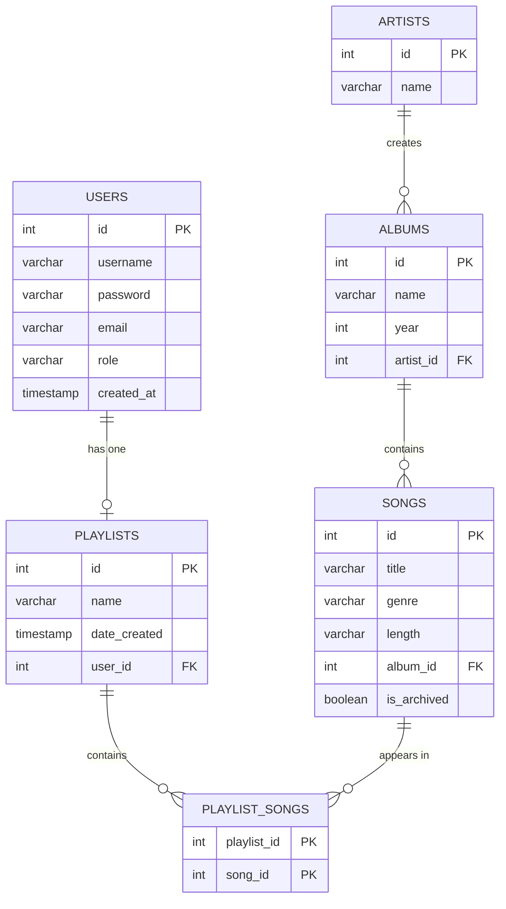

# 🎵 RecordingStudioConsoleApp

> 📝 **STUDENT NOTES (delete this whole block before pushing):** Every line marked `📝 REPLACE` must be changed to match *your own* project. Read the whole file, replace the placeholders `<like-this>`, and remove all notes. Do not leave any `📝` text in your final README.

A Java console application for managing a recording studio's catalog of **artists, albums, songs, users, and playlists**. Built with **JDBC and MySQL** using a clean **3-tier architecture**, and built as my final project for the **Programming (Java) NC III** course.

---

## Table of Contents

- [Features](#features)
- [Tech Stack](#tech-stack)
- [Architecture](#architecture)
- [Project Structure](#project-structure)
- [Database Design](#database-design)
- [Use Cases](#use-cases)
- [Getting Started](#getting-started)
- [Running the App](#running-the-app)
- [Sample Usage](#sample-usage)
- [Design Decisions](#design-decisions)
- [Troubleshooting](#troubleshooting)
- [Author](#author)

---

## Features

> 📝 **REPLACE / REVIEW:** List only the features your app really has. Remove anything you did not finish and add any extras you built.

- **Full CRUD** for Artists, Albums, Songs, and Playlists
- **One playlist per user** (1:1 relationship, enforced by a `UNIQUE` constraint on `playlists.user_id`)
- **Soft delete (archive / restore)** for Songs, so data is never lost by accident
- **Search** by keyword (Songs, Artists, Albums)
- **Login and registration** with BCrypt password hashing
- **Role-based access control**:
  - `USER`: browse the catalog, search songs, and manage their own playlist
  - `ADMIN`: everything a user can do, plus manage Artists, Albums, Songs, and Users
- **Many-to-many playlists**: add and remove songs in a playlist
- **User-friendly console UX**:
  - Descriptive error messages (for example, "No song found with ID 5. Please check the ID and try again.")
  - Press **Enter to keep the current value** when updating
  - **Y/N confirmation** before destructive actions
  - The list is **re-displayed after every create, update, or delete**
- **SQL injection safe**: every query uses `PreparedStatement`

---

## Tech Stack

| Area | Technology |
|---|---|
| Language | Java 17 |
| Database | MySQL 8.x |
| Data access | JDBC (`PreparedStatement`, try-with-resources) |
| Build tool | Maven |
| Password hashing | jBCrypt (`org.mindrot:jbcrypt`) |
| IDE (recommended) | IntelliJ IDEA |

---

## Architecture

The app follows a **3-tier architecture** with a strict one-way flow:

```
┌──────────────────────┐
│  Presentation Tier   │   Views: Scanner input, System.out output
└──────────┬───────────┘
           │ calls
┌──────────▼───────────┐
│     Service Tier     │   Business logic and validation
└──────────┬───────────┘
           │ calls
┌──────────▼───────────┐
│  Data Access Tier    │   Repositories: JDBC and SQL only
└──────────┬───────────┘
           │
        ┌──▼──┐
        │MySQL│
        └─────┘
```

| Tier | Responsibility | Must **not** |
|---|---|---|
| **Presentation** | Show menus, read input, display results and messages | Contain SQL or business rules |
| **Service** | Validate data, enforce rules, coordinate repositories | Read input or print UI messages |
| **Repository** | Run SQL through JDBC, map rows to objects | Print messages or validate business rules |

The **model** package (plain Java objects) and **config** package (database connection) are shared by all tiers.

**Key principles applied:** Separation of Concerns, DRY, composition over inheritance (constructor injection), and programming to interfaces.

---

## Project Structure

> 📝 **REPLACE:** Make this tree match your actual folders and file names. Remove entries you did not create and add any extra ones (for example, `Menu.java` or utility classes).

```
RecordingStudioConsoleApp
├── pom.xml
├── database
│   └── schema.sql
└── src/main/java/com/joysistvi/recordingapp
    ├── App.java                      # Entry point: wires the tiers together
    ├── config
    │   └── DbConnection.java         # Database connection settings
    ├── model
    │   ├── Artist.java
    │   ├── Album.java
    │   ├── Song.java
    │   ├── Playlist.java
    │   └── User.java
    ├── presentation                  # Tier 1
    │   ├── ArtistView.java
    │   ├── AlbumView.java
    │   ├── SongView.java
    │   ├── PlaylistView.java
    │   └── UserView.java
    ├── service                       # Tier 2
    │   ├── ArtistService.java        (interface)
    │   ├── ArtistServiceImpl.java
    │   └── ...                       (same pattern for each entity)
    └── repository                    # Tier 3
        ├── ArtistRepository.java     (interface)
        ├── ArtistRepositoryImpl.java
        └── ...                       (same pattern for each entity)
```

---

## Database Design

> 📝 **REPLACE / REVIEW:** Make sure the tables and columns match your own `schema.sql`. If you added columns or tables, update the diagram and the table below.

**Database name:** `recording_studio`

### Entity relationships

- An **Artist** creates many **Albums**
- An **Album** contains many **Songs**
- A **User** has one **Playlist** (1:1)
- A **Playlist** contains many **Songs** (many-to-many through `playlist_songs`)



### Tables

| Table | Columns |
|---|---|
| `artists` | `id`, `name` |
| `albums` | `id`, `name`, `year`, `artist_id` (FK) |
| `songs` | `id`, `title`, `genre`, `length` (text, e.g. `3:45`), `album_id` (FK), `is_archived` (default `FALSE`) |
| `users` | `id`, `username` (unique), `password` (BCrypt hash), `email` (unique), `role` (`USER` or `ADMIN`, default `USER`), `created_at` |
| `playlists` | `id`, `name`, `date_created`, `user_id` (FK, **UNIQUE**, which enforces the 1:1 relationship with `users`) |
| `playlist_songs` | `playlist_id` (FK), `song_id` (FK), composite primary key, `ON DELETE CASCADE` |

---

## Use Cases

> 📝 **REPLACE / REVIEW:** Match this to your own use case diagram (you can embed it with ``).

**Both actors:** Login

**User:**
- Register Account
- Browse Artists, Albums, and Songs
- Search Songs
- Manage Own Playlist
- Add / Remove Songs in Playlist

**Admin:**
- Manage Artists
- Manage Albums
- Manage Songs (including archive and restore)
- Manage Users

> Self-registration always creates an account with role `USER`. Admin accounts are created manually in the database (see below).

---

## Getting Started

### Prerequisites

- **JDK 17** or newer
- **MySQL 8.x** running locally
- **Maven 3.8+** (or use the one bundled with IntelliJ IDEA)
- Git

### 1. Clone the repository

```bash
git clone https://github.com/<your-github-username>/<your-repository-name>.git
cd <your-repository-name>
```

> 📝 **REPLACE:** your GitHub username and your repository name.

### 2. Create the database

Run the script in MySQL Workbench or the MySQL CLI:

```bash
mysql -u root -p < database/schema.sql
```

This creates the `recording_studio` database, all tables, and some sample artists, albums, and songs.

### 3. Configure the connection

Open `src/main/java/com/joysistvi/recordingapp/config/DbConnection.java` and update the credentials:

```java
private static final String URL = "jdbc:mysql://localhost:3306/recording_studio";
private static final String USER = "root";
private static final String PASSWORD = "your_password_here";
```

> 📝 **REPLACE:** If your `DbConnection` class or constants are named differently, update the path and code above.

> ⚠️ Never commit real passwords to GitHub. Keep your local credentials out of version control, or load them from environment variables.

### 4. Create an admin account (optional)

1. Run the app and register a normal account.
2. Promote it in MySQL:

```sql
UPDATE users SET role = 'ADMIN' WHERE username = 'your_username';
```

---

## Running the App

### Option A: From IntelliJ IDEA

1. Open the project and let Maven import the dependencies.
2. Run `App.java`.
3. (Optional) To enable screen clearing, turn on **Run Configuration → Modify options → Emulate terminal in output console**.

### Option B: From the terminal (runnable JAR)

The project uses the **Maven Shade Plugin** to bundle the MySQL driver into one jar.

```bash
mvn clean package
java -jar target/RecordingStudioConsoleApp-1.0-SNAPSHOT.jar
```

> Running with `mvn exec:java` can fail with `No suitable driver found`, because the plugin uses an isolated classloader. Use the shaded jar instead.

### Option C: Build the jar with IntelliJ Artifacts

This method builds a runnable `.jar` directly from IntelliJ, without Maven.

#### Step 1: Create the artifact

1. Go to **File → Project Structure → Artifacts**.
2. Click **+ (Add) → JAR → From modules with dependencies**.
3. Under **Main Class**, select `App` (the class that contains the `main()` method).
4. Leave the other settings as default, then click **OK**.
5. Click **Apply**, then **OK**.

#### Step 2: Build the artifact

1. Go to **Build → Build Artifacts**.
2. Select your artifact (for example, `RecordingStudioCliApp:jar`) and click **Build**.
3. Wait for the progress bar at the bottom right of IntelliJ to finish.

#### Step 3: Find the artifact folder name

Open a terminal (the IntelliJ Terminal tab works) in your project's root folder, then list the contents of `out\artifacts`:

```powershell
dir out\artifacts
```

The folder name shown is your artifact folder (for example, `RecordingStudioCliApp_jar`).

> The folder name matches your artifact name, with `:jar` shown as `_jar`.

#### Step 4: Go into the artifact folder

Use a **relative path** (do not start with `\`):

```powershell
cd out\artifacts\RecordingStudioCliApp_jar
dir
```

The `dir` command shows the `.jar` file inside (for example, `RecordingStudioCliApp.jar`).

> **Common mistake:** `cd \out\artifacts\...` starts with a backslash, which means "from the root of the drive" (`C:\`), so the path is not found. Remove the leading `\`.

#### Step 5: Run the jar

```powershell
java -jar RecordingStudioCliApp.jar
```

Use the exact `.jar` filename shown by `dir`.

#### Notes

- Run these commands from your project root so the relative paths work.
- Rebuild the artifact (**Build → Build Artifacts → Rebuild**) every time you change the code, otherwise the jar will run the old version.
- Make sure MySQL is running and the credentials in `DbConnection.java` are correct before running.

---

## Sample Usage

> 📝 **REPLACE:** The output below is only an example. Run your own app, copy your real menus, and add screenshots (put images in a `screenshots/` folder and use ``).

```
===== Welcome to Recording Studio =====
1. Login
2. Register
0. Exit
Choose: 1

===== Songs =====
1. View all songs
2. Search song
3. Add song              (Admin only)
4. Update song           (Admin only)
5. Archive song          (Admin only)
6. Restore song          (Admin only)
7. View archived songs   (Admin only)
0. Back

----- Update Song -----
ID    Title                     Genre           Length   Album
1     Ligaya                    OPM Rock        4:40     Cutterpillow
Song ID to update: 1
New Title [Ligaya] (Enter to keep):
```

---

## Design Decisions

> 📝 **REPLACE / REVIEW:** Keep only the decisions that match what *you* actually implemented. Add your own decisions and explain why you made them.

- **Role stored as `VARCHAR`** (`USER` or `ADMIN`) instead of a boolean or enum to keep the code simple and beginner-friendly.
- **Soft delete for songs** (`is_archived`) so playlists and history are not broken by a delete.
- **BCrypt for passwords**: plain-text passwords are never stored.
- **Service owns validation, View owns messages**: services stay silent and return results, so the user never sees the same error twice.
- **Repositories never print success messages**: they only log SQL errors.
- **Interfaces for services and repositories** so implementations can be swapped (for example, for testing).
- **Song `length` stored as text** (for example, `3:45`) for simplicity.

---

## Troubleshooting

| Problem | Fix |
|---|---|
| `No suitable driver found for jdbc:mysql://...` | Run the shaded jar (`java -jar target/...jar`), not `mvn exec:java` |
| `Access denied for user 'root'` | Check the `USER` and `PASSWORD` values in `DbConnection.java` |
| `Unknown database 'recording_studio'` | Run `database/schema.sql` first |
| `Communications link failure` | Make sure the MySQL server is running on port 3306 |
| Screen does not clear in IntelliJ | Enable **Emulate terminal in output console** in the Run Configuration |
| `mvn` is not recognized (Windows) | Add Maven's `bin` folder to the `PATH` environment variable and reopen the terminal |

---

## Author

**<Your Full Name>**
Student, Programming (Java) NC III, Joysis Tech Voc Inc.
GitHub: [@<your-github-username>](https://github.com/<your-github-username>)

> 📝 **REPLACE:** your name, your GitHub username, and your batch or section if required. Credit your instructor or any resources you used (optional).

---

## Acknowledgements

- Course instructor: Jareth Ronquillo, Joysis Tech Voc Inc.
